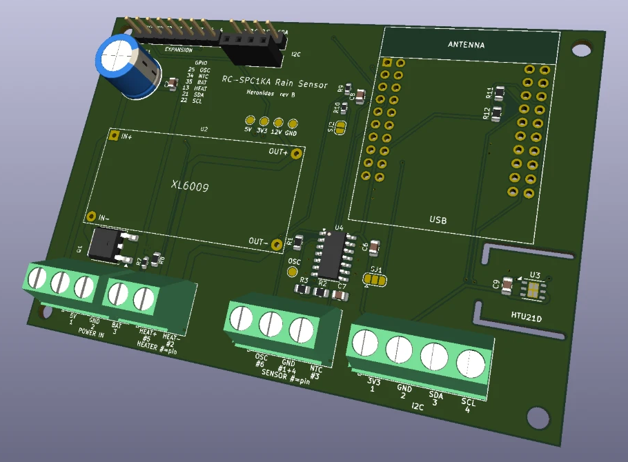
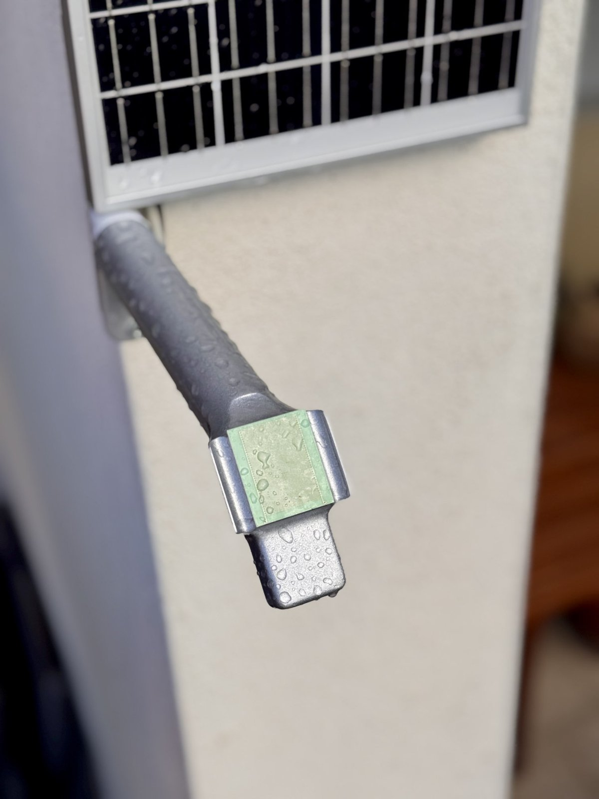

# 🌧️ ESPHome Kapazitiver Regensensor

**Ein beheizter, versiegelter Regensensor für Home Assistant, der Regen von Tau und Nebel unterscheidet.** 
Sensorelement RC-SPC1KA · ESP32-Trägerplatine · ESPHome-Firmware

[English](README.md) · **Deutsch**

Trägerplatine Rev B, 100 × 70 mm. ESP32 D1 mini und XL6009-Modul werden aufgesteckt.

---

Die ausführliche Dokumentation (Wiki, Bauanleitung) gibt es auf Englisch. Diese Seite fasst das Projekt auf Deutsch zusammen und führt dich zu den richtigen Stellen.

## 💡 Warum dieser Sensor

Günstige Regensensoren nutzen Kupferkämme, die nach einer Saison korrodiert sind, oder Kippwaagen, die erst nach einer messbaren Regenmenge melden. Fertige Zigbee- und WLAN-Sensoren melden *Regen: ja/nein*, und wenn sie Morgentau für Regen halten, kannst du nichts daran ändern.

- **Versiegeltes kapazitives Element.** Die Elektroden liegen unter einer geschlossenen Oberfläche, es gibt kein offenes Metall. Wenige Tropfen reichen.
- **Wertet aus, wie sich der Messwert bewegt.** Regen lässt ihn springen, Tau und ein ruhender Wasserfilm halten ihn ruhig. Die Firmware erkennt Regen am schnellen Anstieg oder an den Sprüngen, die Höhe allein löst nichts aus.
- **Beheizt.** Nach dem Regen trocknet die Heizung die Fläche in einem kurzen Lauf, und sie taut Reif ab.
- **Einstellbar.** Hardware und Firmware liegen offen. Schwellen, Heizgrenzen und Nachtmodus änderst du in Home Assistant oder auf der Webseite des Geräts, ohne neu zu flashen.

## ✨ Was er kann

- Wetterlage *trocken* oder *Regen*, dazu ein eigener Zustand, wenn der Oszillator steht
- Regenbeginn am Anstieg (trockene Platte) oder an den Sprüngen (nasse Platte), Regenende nach wenigen ruhigen Minuten
- Frostsperre: kein falscher Regen durch tauenden Reif oder Schnee
- Ein Trocknungslauf 15 Minuten nach Regenende, Frostheizung unter 1 °C
- Heizung mit einstellbarer Abschalttemperatur, Heizzeit-Budget und Akkuschutz
- Nachtmodus mit Deep Sleep und Wecken alle 5 Minuten
- Home Assistant über die native API, oder MQTT mit lokaler Webseite (FHEM, ioBroker, Node-RED)
- Firmware mit deutschen oder englischen Entitätsnamen

Zwei Monate draußen neben einem Kippwaagen-Regenmesser: Der Sensor meldete den Regenbeginn 2–5 Minuten vor der ersten Kippung.

## 🚦 Stand

| Teil | Stand |
|---|---|
| Firmware, deutsch, Home-Assistant-API | ✅ läuft seit 24. Oktober draußen auf der Platine Rev A |
| Firmware, englisch und MQTT-Varianten | 🟡 gleiche Logik, aus der deutschen Datei erzeugt; kompiliert, lief noch auf keinem Gerät |
| Regenerkennung im echten Regen | ✅ an mehr als zehn Regentagen getestet |
| Platine Rev A | ✅ läuft draußen mit externem XL6009-Modul |
| Platine Rev B | ⚪ Layout fertig, Fertigungsdaten im Repo, noch nicht bestellt |
| Sensorhalter | ✅ seit 24. Oktober draußen |

## 🚀 Loslegen

1. **Teile.** Die Platine von JLCPCB mit ESP32 D1 mini und XL6009-Modul ([Bestellen](docs/wiki/Ordering-the-Board.md)) oder ein Aufbau aus Modulen auf Lochraster ([Bauanleitung, PDF](docs/module-build-guide.pdf)), dazu ein RC-SPC1KA ([Teile](docs/wiki/Parts.md)).
2. **Verdrahtung.** Sensor an SENSOR und HEATER, 5 V an POWER IN ([Verdrahtung](docs/wiki/Wiring.md)).
3. **Flashen.** Den D1 mini einmal per USB flashen. Nimm dafür [`firmware/examples/regensensor.yaml`](firmware/examples/regensensor.yaml): Sie lädt die deutsche Firmware aus diesem Repository. Spätere Updates laufen über WLAN ([Flashen und Updates](docs/wiki/Flashing-and-Updates.md)).
4. **Einmessen.** Trockenfrequenz draußen messen und eintragen ([Kalibrierung](docs/wiki/Calibration.md)).
5. **Home Assistant** findet das Gerät von selbst. Ohne Home Assistant nimmst du die Variante [MQTT und Webseite](docs/wiki/MQTT-and-Web-Page.md).

Die Namen aller Entitäten auf Deutsch und Englisch, mit Standardwerten, stehen unter [Entities](docs/wiki/Entities.md).

## 📄 Lizenz

Die Firmware steht unter der GPL. Die Hardware darfst du privat und nicht-kommerziell nutzen; für kommerzielle Nutzung brauchst du meine schriftliche Erlaubnis.

| Teil | Lizenz |
|---|---|
| Hardware, Fertigungsdaten, Sensorhalter, Dokumentation | [CC BY-NC-SA 4.0](LICENSES/CC-BY-NC-SA-4.0.txt) |
| Firmware und Tools | [GPL-3.0-or-later](LICENSES/GPL-3.0.txt) |

Details in [`LICENSE.md`](LICENSE.md).

RC-SPC1KA ist ein Produkt der Radiocontrolli S.r.l. Dieses Projekt ist unabhängig und steht in keiner Verbindung zu Radiocontrolli.
