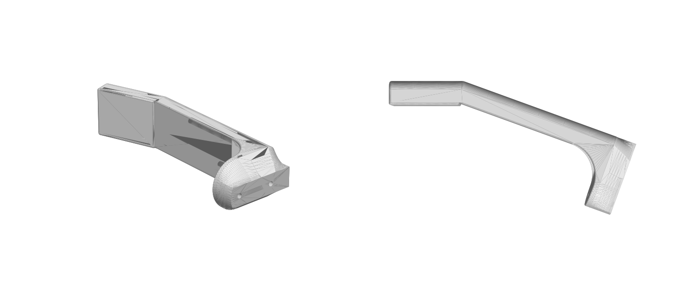

# ESPHome Capacitive Rain Sensor (RC-SPC1KA + ESP32)

Heated capacitive rain sensor for Home Assistant that can grow into a small weather station: KiCad carrier board (orderable assembled from JLCPCB), ESPHome firmware and build notes.

**Status: rev A, ordered but not yet built or tested.** See [Known limitations](#known-limitations).

*Rev A, 72 x 56 mm, KiCad 3D view. The magenta dots mark pin 1 (as in the JLCPCB preview).*

## The sensor

The RC-SPC1KA (Radiocontrolli) is a sealed capacitive rain sensor. There is no exposed metal, so nothing corrodes, and it has two extras: a heater (about 42 ohm, roughly 3.4 W at 12 V) and an NTC (1 kOhm at 25 C) for the surface temperature. Dry it measures about 100 pF; a soaked surface reads several thousand pF.

Available from distributors, for example [Novaut](https://www.novaut.com/en/620521-rc-spc1ka-radiocontrolli.html) (about 13 EUR incl. VAT, EU shipping), [TME](https://www.tme.com/us/en-us/details/rc-spc1ka/humidity-sensors/radiocontrolli/) or [DigiKey](https://www.digikey.com/en/products/detail/radiocontrolli/RC-SPC1KA/13688193). Prices and stock as of 2026-09; not affiliated with any of them.

It is only the element, so this project adds the rest: a board that reads it and powers the heater from 5 V, and firmware that turns the raw readings into rain / dew / drizzle / dry and runs the heater safely.

## How it works

**Measurement.** The sensor capacitance sits in a relaxation oscillator (SN74HC14, 1 MOhm). Wetter surface, larger capacitance, lower frequency. The ESP32 counts the pulses with the hardware PCNT peripheral, which is much quieter than software counting. You measure the frequency of your own dry sensor once and enter it as *Trockenfrequenz*; that value defines 100 pF and everything else is scaled to it (`C = f_dry * 100 / f`). Cable length and layout drop out of the calibration, so keep the cable as it was when you calibrated.

**Rain or dew.** Capacitance says how wet, not why: heavy dew reaches the same values as light rain, and the sensor also reacts to humid air before any liquid water is there (a reversible adsorbed film). The firmware adds two criteria:

* rate of rise (rain: hundreds of pF/min, condensation: a few pF/min)
* dew point: with outdoor temperature and humidity from Home Assistant it checks whether the surface is at or below the dew point. Without them it falls back to "surface clearly colder than the enclosure air, and dark".

Result is the *Wetterlage* text: `trocken`, `Tau`, `Niesel`, `trocknet ab`, `Regen`.

**Heater.** Wet but not raining hard: heat, so the sensor reports dry soon after the rain stops (and melts snow and frost). Off at 45 C surface temperature, back on below 40 C, checked every second (about 0.7 K/s heating rate). No heating during real rain. Heating time is budgeted (default 15 min, then a 2 h pause) so fog or drizzle cannot keep it running for hours. Implausible NTC readings (open or shorted wire) switch it off. It always starts off after a reset.

**Battery.** Optional night mode: deep sleep with a 5 min wake interval. Off by default.

## Parts

* This board, assembled by JLCPCB (see [Ordering](#ordering-jlcpcb)); the screw terminals and pin headers are hand-soldered.
* RC-SPC1KA.
* 5 V supply, 1.5 A or more. The heater draws about 0.8 A at 5 V (my estimate from 3.4 W plus boost losses, not measured). Developed with the Waveshare Solar Power Manager (D).
* USB-UART adapter, 3.3 V logic, for the first flash. Updates go over WiFi.
* Optional: VEML7700 (I2C, 0x10), HTU21D (GY-21) inside the enclosure.
* Cable to the sensor head (the prototype uses 8-core), IP67 enclosure with desiccant. Keep metal and walls away from the antenna at the board's top edge.

## Build

**Wiring.** Sensor pin numbers as in the RC-SPC1KA datasheet. The silkscreen prints them next to the terminals (`#6`, `#1+4`, ...).

| Terminal | Board pin | Sensor pin | Function |
|---|---|---|---|
| SENSOR | OSC | 6 | capacitor, oscillator node |
| SENSOR | GND | 1 and 4 | capacitor ground side (outer electrode), NTC |
| SENSOR | NTC | 3 | NTC |
| HEATER | HEAT- | 2 | heater, switched ground |
| HEATER | 12V | 5 | heater, +12 V |
| HEATER | GND | not used | |

The sensor has three isolated groups: capacitor (1, 6), heater (2, 5, about 42 ohm) and NTC (3, 4, about 1 kOhm at room temperature). Pins 1 and 4 are joined only on the board, at the SENSOR GND pin. A quick meter check of these values before powering up catches wiring mistakes.

OSC must never touch 12 V. VEML7700 on the I2C terminal or Qwiic, HTU21D in the socket labelled HTU21D. Power on POWER IN (5V, GND; reverse-polarity protected). BAT is only for battery-voltage monitoring (1S Li-ion, up to 4.2 V through the 100k/100k divider); leave it open otherwise.

**Flashing.** No USB port on the board; use the UART header J7 (adapter RX to TX, TX to RX, GND to GND) and power the board through POWER IN, since J7 has no power pin. Hold BOOT, tap RESET, release BOOT, then `esphome run firmware/regensensor.yaml`. The config validates with ESPHome 2026.6.5. It needs `secrets.yaml` with `wifi_ssid`, `wifi_password`, `regensensor_api_key`, `regensensor_ota_password`. Set `aussen_temp_entity` and `aussen_feuchte_entity` in the substitutions to your outdoor sensors; if they do not exist the sensors stay empty and the fallback applies.

## Building without the PCB

The SMD parts on the board are too small for most people to solder by hand, so the options are the assembled board from JLCPCB (see [Ordering](#ordering-jlcpcb)) or a perfboard build from ready-made modules like the prototype.

The circuit is small. Use an ESP32 dev board (3.3 V regulator on board) and wire the rest on perfboard. Pins are the same as in the [GPIO map](#gpio-map), so the firmware runs unchanged.

Parts:

* ESP32 dev board (30 or 38 pin, any with GPIO13, 21, 22, 25, 34, 35 broken out)
* SN74HC14 (DIP-14 works), 100 nF, 1 MΩ
* NTC pull-up: 2.8 kΩ (two 5.6 kΩ in parallel, or 2.7 kΩ), 100 nF
* MT3608 boost module, set to 12 V
* N-MOSFET, logic level, e.g. IRLZ44N or AO3400A on a breakout, 100 Ω gate resistor, 100 kΩ gate pull-down
* Optional battery monitor: 2 x 100 kΩ

Wiring:

| From | To |
|---|---|
| 74HC14 pin 14 | 3.3 V, with 100 nF to GND next to it |
| 74HC14 pin 7 | GND |
| 74HC14 pins 3, 5, 9, 11, 13 | GND (unused inputs) |
| 74HC14 pin 2 (output) | GPIO25 |
| 1 MΩ | between 74HC14 pins 1 and 2 |
| Sensor pin 6 (OSC) | 74HC14 pin 1 |
| Sensor pins 1 and 4 | GND |
| Sensor pin 3 (NTC) | GPIO34, 2.8 kΩ to 3.3 V, 100 nF to GND |
| Sensor pin 5 (+12 V) | boost module OUT+ |
| Sensor pin 2 (HEAT-) | MOSFET drain |
| MOSFET source | GND |
| MOSFET gate | GPIO13 via 100 Ω, 100 kΩ from gate to GND |
| Boost module IN+ / GND | 5 V supply / GND |
| Boost module GND, ESP32 GND | common ground |
| I2C SDA / SCL | GPIO21 / GPIO22, 4.7 kΩ pull-ups to 3.3 V |
| Battery (optional) | 100 kΩ to GPIO35, 100 kΩ from GPIO35 to GND, `batt_teiler_faktor` 2.0 |

Notes:

* Keep the wire from sensor pin 6 to the 74HC14 short, the oscillator input is high impedance. Long leads add capacitance and shift the readings. Then re-run the [calibration](#calibration).
* Set the boost module to 12 V before connecting the sensor. Check with a multimeter.
* Modules without an enable pin keep the boost converter running all the time. That costs idle current, so it is fine on a mains supply and a poor choice for battery operation. The board switches the converter off through the MT3608 EN pin.
* Power the 74HC14 from the ESP32's 3.3 V, not 5 V, so the oscillator output stays within GPIO limits.

## Sensor holder (3D printed)

`mechanical/sensor-holder.stl`, about 228 x 124 x 50 mm, fits a 256 mm printer bed. The file contains **three parts; separate them in the slicer** (Bambu Studio: right click, Split, To Parts).

**Material and finish**
* **ASA, white.** ASA is UV and weather resistant, white keeps the head from heating up in the sun. PLA and PETG are not suitable for permanent outdoor use here.
* FDM prints are not watertight (layer lines are porous). Seal the printed parts with a **clear lacquer** (UV-stable, outdoor type) so moisture cannot creep into the holder. Keep the sensor face itself free of lacquer.

**Mounting the sensor**
* **Glue it in carefully.** The back of the RC-SPC1KA with the heater and NTC solder pads is **not protected against corrosion**. The bond has to be fully sealed around the whole sensor edge so no water reaches the rear. The prototype uses a transparent MS polymer adhesive (UHU Polymax Express) and Kapton tape over the pads on the back.
* Neutral-curing adhesives only. Acetic-acid (vinegar smell) silicone attacks solder joints and copper.
* Degrease the bonding surfaces (isopropanol) and let the adhesive cure fully before going outside.
* Keep glue off the sensor face and away from the edge where water runs off; a glue bead there holds a water film and reads as wet.
* Solder the wires and **test the sensor and the VEML7700 before gluing**; afterwards nothing is reworkable.
* Route the cable so it leaves the holder downwards, with a drip loop, and add strain relief. Use a cable rated for outdoor use (plain LiYY is not UV resistant; protect it or use an outdoor type).
* If the VEML7700 sits behind a cover or lacquer, set `veml_glasfaktor` in the YAML.
* Use stainless screws for the wall mounting.

## Calibration

1. **Dry frequency.** Surface dry, heater off. Average *Frequenz* over a few minutes and enter it as *Trockenfrequenz*. The default in the YAML (13549 Hz) is a placeholder from the vendor example.
2. **NTC.** Reference thermometer next to the head, same air, no sun, heater off for 30 min. Trim with `adc_faktor` (coarse) or *NTC Offset* (fine, +-5 K). Do not calibrate against air temperature under a clear night sky: the plate is legitimately colder, that is the dew signal.
3. **Thresholds.** Start values: display 300 pF, heat 380 pF, rain 650 pF (the datasheet table gives 320 / 450 / 2000). Run a wet test and set your own via the number entities; no reflash.
4. **Humid nights.** Note the maximum capacitance in a dry but humid night and keep the thresholds above it (*Abstand zum Taupunkt* helps), otherwise every fog reads as wet.
5. Leave *Automatikbetrieb* off the first night to see the raw values without heater influence.

## Entities in Home Assistant

Names are German (the firmware began as a private project); kept for compatibility.

| Entity | Meaning |
|---|---|
| Wetterlage | trocken, Tau, Niesel, trocknet ab, Regen |
| Regen, Feucht | binary sensors |
| Kapazität, Benetzung | capacitance in pF, wetting in % |
| Oberflächentemperatur | sensor surface temperature |
| Taupunkt, Abstand zum Taupunkt | outdoor dew point, surface minus dew point |
| Heizung, Automatikbetrieb | heater switch, master switch for automatic heating and night mode |
| Nachtmodus | allows deep sleep in the night window (off by default) |
| Heizsperre aktiv, Heizkonto, Sperre verbleibend | heating-time limit |
| Trockenfrequenz, *-schwelle, ... | calibration and settings, adjustable at runtime |
| Helligkeit, Sonneneinstrahlung, Box Temperatur/Luftfeuchte, Batteriespannung | optional sensors |

The API action `set_aussenluft(temperatur, feuchte)` lets an automation push outdoor values instead of subscribing to entities.

## Troubleshooting

| Symptom | Cause |
|---|---|
| Kapazität unknown | *Trockenfrequenz* not set, or no oscillator signal |
| Frequenz 0 | Oscillator stopped: OSC wire, GND, soaked surface. Reported as wet. |
| Frequenz jumps | I2C crosstalk (median-filtered already), weak GND at sensor pin 1, very long cable |
| Surface temperature NaN, heater never runs | Implausible NTC resistance (open or shorted): check the SENSOR terminal. Deliberate, the heater stays off. |
| Humid nights read wet or Tau | Thresholds too low, calibration step 4 |
| Heater stops after 15 min | Heating limit (*Max. Heizdauer*); resumes after *Heizpause* |
| Does not wake after night mode | Needs a valid clock and a supply that stays on at low load; switch *Nachtmodus* off to keep it awake |

## Board reference

* 72 x 56 mm, 2 layers, 4x M3 holes, ESP32 antenna overhangs the top edge (keep metal and enclosure walls away from it)
* Input: **5 V** (e.g. Waveshare Solar Power Manager (D), USB, any 5 V supply, <= 3 A). No solar/battery charging on this board.
* On board: AP2112K 3.3 V LDO, MT3608 boost to a fixed **12 V** for the sensor heater (switched by GPIO13 through a low-side MOSFET), reverse-polarity PMOS, SN74HC14 relaxation oscillator, NTC divider, optional battery-voltage divider, I2C pull-ups, BOOT/RESET buttons, UART header
* I2C: Qwiic/STEMMA-QT (JST-SH), 1x4 2.54 mm socket and a 4-pin screw terminal, all in parallel

### Connectors

| Ref | Function | Pins (1 -> n) |
|---|---|---|
| J1 | Power in | 5V, GND, BAT (battery voltage sense input, optional) |
| J6 | I2C screw terminal | 3V3, GND, SDA, SCL |
| J3 | Sensor heater | GND, HEAT- (switched return), +12V |
| J2 | Sensor capacitor/NTC | OSC (cap. node), GND, NTC |
| J4 | I2C socket, silkscreen "HTU21D" (any 3V3/GND/SCL/SDA module) | 3V3, GND, SCL, SDA |
| J5 | Qwiic (legend on silkscreen, top to bottom: 4 SCL, 3 SDA, 2 3V3, 1 GND) | GND, 3V3, SDA, SCL |
| J7 | UART programming | GND, TXD, RXD, IO0, EN (no power pin - power the board via J1) |
| J8 | Expansion | 3V3, GND, IO32, IO33, IO26, IO27, IO14, IO4 |

Silkscreen: each screw terminal is labelled below the block with pin function and pin number. On the HEATER and SENSOR terminals `#n` is the wire/pin number of the RC-SPC1KA (`#-` = unused). The J2/J3 order keeps the sensitive oscillator node away from 12 V.

### GPIO map

| GPIO | Use |
|---|---|
| 21 / 22 | I2C SDA / SCL (4.7 k pull-ups) |
| 13 | Heater enable: boost EN + MOSFET gate (100 k pulldown, default off) |
| 25 | Oscillator input (PCNT) |
| 34 | NTC (2.8 k pull-up to 3V3 via SJ1) |
| 32 | Alternative NTC pull-up drive: move SJ1 to pad 3 to power the divider only when needed |
| 35 | Battery voltage through 100k/100k (SJ2 bridged by default; cut it to remove the divider load) |
| 0 / EN | BOOT / RESET buttons and J7 |

### Solder jumpers
* **SJ1** (default 3V3 -> NTC pull-up): cut and bridge the other side to drive the pull-up from GPIO32.
* **SJ2** (default bridged): closes the battery divider to GND. Leave bridged; if left open GPIO35 sees the unattenuated battery voltage.

### Ordering (JLCPCB)
1. PCB: upload `fabrication/regensensor_gerbers.zip`, 2 layers, 1.6 mm, HASL lead-free is fine.
2. Assembly: enable SMT assembly, top side. The ESP32 module (C701341) is only offered in **Standard PCBA** (one-time 25 USD setup fee per side; JLCPCB adds edge rails, board becomes 72 x 70 mm in the panel and the rails break off).
3. Upload `fabrication/bom_jlcpcb.csv` and `fabrication/cpl_jlcpcb.csv`, then check that every line has stock (swap a part with the magnifier if not; the 100k resistor and SS34 diode numbers in the BOM were chosen for stock).
4. **Check the placement preview.** The magenta dot marks pin 1. In the CPL, U2 and U3 (SOT-23-5/-6) are rotated 270 degrees because JLCPCB's models are turned 90 degrees against KiCad's footprints. Q1/Q2 (SOT-23) use 180. Verify U1-U4, Q1, Q2, D1 and J5 anyway.
5. Product info: e.g. Sensor / Rain gauge (HS 901590). Shipping to Germany: EuroPacket is a good compromise, check that import VAT is included at checkout.
6. Through-hole parts (J1, J2, J3, J6 screw terminals; J4, J7, J8 headers) are not in the BOM: solder them yourself. J5 (Qwiic) and L1 are assembled.

## Sensors and extensions

| Sensor | Connection | Status |
|---|---|---|
| RC-SPC1KA (capacitance, NTC, heater) | screw terminals SENSOR / HEATER | in firmware |
| VEML7700 light sensor | I2C (Qwiic, socket or terminal), address 0x10 | in firmware |
| HTU21D temperature/humidity (inside the enclosure) | I2C, socket labelled HTU21D | in firmware |
| Battery voltage | J1 pin BAT | in firmware |
| Pressure (BME280/BMP280), UV (LTR390), CO2 etc. | I2C, 3.3 V modules | hardware supports it, no ESPHome config yet, untested |
| Wind (pulse anemometer), tipping bucket, DS18B20 | expansion header J8: 3V3, GND, IO32, IO33, IO26, IO27, IO14, IO4 | hardware supports it, no ESPHome config yet, untested |

IO32 is also the alternative NTC pull-up drive (see solder jumpers). The expansion header has no 5 V pin.

## Known limitations
* Footprints for the screw terminals (Phoenix PT 1,5 3.5 mm screw terminal as stand-in for KF350-3.5), the inductor (Bourns SRN6045TA stand-in for CKCS6028) must be compared against the datasheets of the parts you actually use.
* C1/C10/C11 (22 uF, 25 V, 0805) lose most capacity at 12 V DC bias; the boost is stable with it but check part availability.
* Feedback divider draws ~24 uA and the NTC pull-up ~0.9 mA permanently unless the GPIO32 option is used (matters for deep-sleep battery use).
* DRC: one intended report remains, the bridged solder jumper SJ2 (deliberate short to GND). Library-not-found warnings appear only if the KiCad footprint libraries are not configured.
* The files were generated with KiCad 7 file formats; KiCad 8-10 upgrade them on opening. Save once and re-run DRC.
* The threshold defaults and the wetting-percent curve are starting values, not from a finished wet test.
* Rev A is a prototype: not yet built or tested. The results will be added here.

## Repository
* `hardware/` KiCad project (schematic, PCB)
* `fabrication/` Gerbers, drill, JLCPCB BOM/CPL
* `firmware/` ESPHome config
* `docs/` images
* `mechanical/` sensor holder STL
* `tools/` Python scripts (KiCad 7 `pcbnew`) that generate the schematic, PCB and fab files from `design.py`
* `.github/workflows/fab.yml` CI: DRC + Gerber export

## Support

If this project saved you some time, you can support it on Ko-fi. Not required, always appreciated.

## License
Hardware, fabrication files and holder: CERN-OHL-P-2.0. Firmware, docs and tools: MIT. See `LICENSE.md`.
