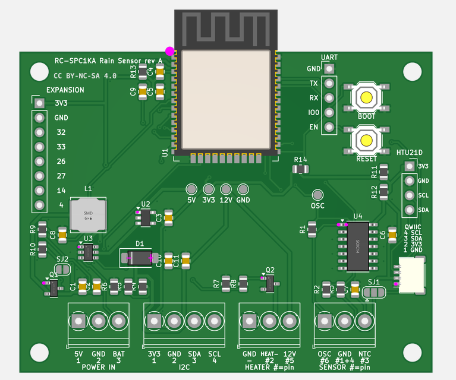

# 🌧️ ESPHome Capacitive Rain Sensor

**A heated, sealed rain sensor for Home Assistant that tells rain from dew.** 
RC-SPC1KA sensor element · ESP32 carrier board · ESPHome firmware

Rev A carrier board, 72 × 56 mm (KiCad 3D view; magenta dots mark pin 1 as in the JLCPCB preview)

[Features](#-features) · [Status](#-project-status) · [Quick start](#-quick-start) · [How it works](#-how-it-works) · [Build](#-build) · [Calibration](#-calibration) · [Home Assistant](#-home-assistant) · [Troubleshooting](#-troubleshooting) · [Hardware reference](#-hardware-reference)

---

## 💡 Why this sensor

Most affordable rain sensors are contact grids that corrode within a season, or tipping buckets that only report once a measurable amount of water has fallen. Off-the-shelf Zigbee and Wi-Fi rain sensors are a black box: you get *rain: yes/no*, and no way to fix it when it reports dew as rain every morning.

This project takes a different approach:

- **Sealed capacitive element.** No exposed metal, nothing to corrode. It reacts to a few drops, not to a bucketful.
- **Heated.** Once the rain stops, the heater dries the surface, so the sensor reports dry within minutes instead of hours. It also clears frost and snow.
- **Knows what it measures.** Rate of rise and dew point separate rain from dew, fog and humid air, exactly where simple sensors raise false alarms.
- **Fully adjustable.** Hardware and firmware are published in full. Thresholds, heater limits and night mode are runtime settings in Home Assistant or on the device's own web page; no reflash needed.

### Typical uses

- Get notified when it starts to rain, before the laundry on the balcony is wet.
- Close roof windows, skylights, awnings or a pergola roof automatically, and open them again once it is dry.
- Turn on a light when heavy rain darkens the room.
- Pause irrigation during and right after rain.
- Log how long and how often it rained; react to frost or snow on the sensor.
- Extend the board with light, pressure, UV or wind sensors and turn it into a small weather station.

---

## ✨ Features

<b>Detection</b>

- [x] Weather state: dry, humid, wet, dew (morning/evening), frost, drizzle, rain
- [x] Drizzle and rain detected by rate of rise, independent of the absolute level
- [x] Dew and frost detection via the surface-to-dew-point distance (frost point below 0 °C)
- [x] Fallback without outdoor data: slow wetting in the dark reads as dew
- [x] Hysteresis on every threshold, no flickering states
- [x] Wetting in % (RC-SPC1K datasheet curve)
- [ ] Fog detection (prepared in the YAML, untested)

<b>Heater control</b>

- [x] Dries the surface after rain, dew or frost
- [x] Stays off during drizzle and rain, so the sensor can see the precipitation
- [x] Rain end detection: no rise for a set time, then a short heater test confirms
- [x] Over-temperature cut-off at 45 °C, checked every second
- [x] Heating-time budget with enforced pause (fog cannot keep it running for hours)
- [x] Safe defaults: off after reset, off on an implausible NTC reading (open or shorted wire)

<b>Connectivity and power</b>

- [x] Home Assistant via the native ESPHome API
- [x] Standalone variant: local web page and MQTT (FHEM, ioBroker, Node-RED, Home Assistant MQTT discovery)
- [x] OTA updates over Wi-Fi
- [x] Optional night mode: deep sleep with 5 min wake interval
- [x] Battery voltage monitoring
- [x] All settings adjustable at runtime, stored across reboots and sleep
- [x] German and English entity names

<b>Hardware</b>

- [x] ESP32 carrier board, 72 × 56 mm, 2 layers, orderable fully assembled from JLCPCB
- [x] Runs from a single 5 V supply; generates the 12 V for the heater on board
- [x] Reverse-polarity protection
- [x] I2C on Qwiic, pin socket and screw terminal; 8-pin expansion header
- [x] Supported add-ons: VEML7700 light sensor, HTU21D enclosure climate
- [ ] BME280, LTR390, anemometer, wind vane, tipping bucket (YAML prepared, untested)
- [x] 3D-printable sensor holder

---

## 🚦 Project status

| Part | Status |
|---|---|
| Firmware | ✅ Running on a perfboard prototype (same pins as the board), tested with spray, drop and soak tests |
| Rain detection in real rain | 🟡 Thresholds set from tests, confirmation in real rain pending |
| Rev A carrier board | 🟡 Ordered, not yet built or tested |
| Sensor holder | ✅ STL available |
| Weather add-ons | ⚪ Prepared in the YAML, untested |

---

## 🚀 Quick start

1. **Get the parts.** Order the assembled board ([Ordering](#ordering-at-jlcpcb)) and an RC-SPC1KA ([The sensor](#-the-sensor)). Alternatively, build it from modules on perfboard with the [Module Build Guide (PDF)](docs/module-build-guide.pdf).
2. **Wire it.** Connect the sensor to the SENSOR and HEATER terminals ([Wiring](#wiring)) and 5 V to POWER IN.
3. **Flash.** First flash over the UART header, then OTA ([Flashing](#flashing)).
4. **Calibrate.** Enter the dry frequency, check the thresholds ([Calibration](#-calibration)).
5. **Integrate.** Home Assistant discovers the device automatically; feed it outdoor air data for the dew point ([Home Assistant](#-home-assistant)).

---

## 🔍 The sensor

The **RC-SPC1KA** from Radiocontrolli is a sealed capacitive rain sensor on an alumina substrate. Besides the sensing capacitor it carries a heater (about 42 Ω, roughly 3.4 W at 12 V) and an NTC (1 kΩ at 25 °C) for the surface temperature.

Dry, it measures about 100 pF. On the prototype a soaked surface reads about 900–1250 pF (RC-SPC1K datasheet: more than 550 pF at full water cover).

It is sold by electronics distributors, for example [Novaut](https://www.novaut.com/en/620521-rc-spc1ka-radiocontrolli.html) (about 13 EUR incl. VAT, EU shipping), [TME](https://www.tme.com/us/en-us/details/rc-spc1ka/humidity-sensors/radiocontrolli/) and [DigiKey](https://www.digikey.com/en/products/detail/radiocontrolli/RC-SPC1KA/13688193). Prices and stock as of 2026-09; this project is not affiliated with any of them, nor with Radiocontrolli.

The element alone does nothing. This project adds the rest: a board that reads it and powers the heater from 5 V, and firmware that turns raw readings into a weather state and runs the heater safely.

---

## 🧠 How it works

**Measurement.** The sensing capacitor sets the frequency of a relaxation oscillator (SN74HC14 with R1 = 220 kΩ). A wetter surface means a larger capacitance and a lower frequency. The ESP32 counts the pulses with its hardware PCNT peripheral, which is far quieter than software counting. You measure your dry sensor once and enter the result as the dry frequency. That value defines 100 pF; everything else scales from it (`C = f_dry × 100 / f`), so cable length and layout drop out of the calibration.

**Rain or dew.** Capacitance says *how* wet, not *why*. Heavy dew reaches the same values as light rain, and the element already reacts to humid air before any liquid water is present. The firmware therefore adds two criteria:

| Criterion | Rain / drizzle | Dew |
|---|---|---|
| Rate of rise | tens to hundreds of pF/min | a few pF/min |
| Surface vs. dew point | any | at or below the dew point |

A fast rise latches **drizzle** (*Drizzle Detection*, default 60 pF/min) or, from the rain level up, **rain** (*Rain Detection*, default 150 pF/min). Both end after *Rain End After* (default 7 min) without a further rise, or when the surface dries. Dew is reported when the surface is within *Dew Threshold* of the dew point; without outdoor data, slow wetting in the dark counts as dew. Dew reads as morning dew from 04:00 to 11:00 and evening dew from 17:00 to 23:00.

**Heater.** The heater dries the film left after rain, and dew or frost once they have ended. It stays off while drizzle or rain is latched, so the sensor can see the precipitation, and while dew or frost is forming, since it would form again at once. After a rain end it dries the surface. If the level is still at rain level after 3 minutes of drying, it is still raining and rain is set again. Rain remains reported until the surface has dried below the rain level, so steady rain never reports a false end.

Safety: off at 45 °C surface temperature, back on below 40 °C, checked every second (the surface heats at about 0.7 K/s). Heating time is budgeted (default 15 min, then a 2 h pause). Implausible NTC readings switch it off, and it always starts off after a reset.

**Battery.** Optional night mode: deep sleep with a 5 min wake interval, about 35 s awake per cycle. Off by default.

---

## 🔧 Build

### Parts

- The carrier board, assembled by JLCPCB ([Ordering](#ordering-at-jlcpcb)); screw terminals and pin headers are hand-soldered
- RC-SPC1KA
- 5 V supply, 1.5 A or more. The heater draws about 0.8 A at 5 V (estimated from 3.4 W plus boost losses, not measured). Tested with the Waveshare Solar Power Manager (D).
- USB-UART adapter with 3.3 V logic for the first flash; updates then go over Wi-Fi
- Optional: VEML7700 light sensor (I2C 0x10), HTU21D (GY-21) inside the enclosure
- Cable to the sensor head (the prototype uses 8-core), IP67 enclosure with desiccant. Keep metal and enclosure walls away from the antenna at the board's top edge.

### Wiring

Sensor pin numbers follow the RC-SPC1KA datasheet. The silkscreen prints them next to the terminals (`#6`, `#1+4`, …).

| Terminal | Board pin | Sensor pin | Function |
|---|---|---|---|
| SENSOR | OSC | 6 | capacitor, oscillator node |
| SENSOR | GND | 1 and 4 | capacitor ground side (outer electrode), NTC |
| SENSOR | NTC | 3 | NTC |
| HEATER | HEAT- | 2 | heater, switched ground |
| HEATER | 12V | 5 | heater, +12 V |
| HEATER | GND | – | not used |

The sensor has three isolated groups: capacitor (1, 6), heater (2, 5, about 42 Ω) and NTC (3, 4, about 1 kΩ at room temperature). Pins 1 and 4 are joined only on the board, at SENSOR GND. A quick check with a multimeter before powering up catches wiring mistakes.

> [!WARNING]
> OSC must never touch 12 V.

Connect the VEML7700 to the I2C terminal or Qwiic, the HTU21D to the socket labelled HTU21D. Power goes to POWER IN (5V, GND; reverse-polarity protected). BAT is only for battery voltage monitoring (1S Li-ion, up to 4.2 V through a 100k/100k divider); leave it open otherwise.

### Flashing

The board has no USB port. Use the UART header J7 (adapter RX to TX, TX to RX, GND to GND) and power the board through POWER IN; J7 has no power pin.

1. Hold BOOT, tap RESET, release BOOT.
2. Run `esphome run firmware/regensensor_de.yaml` (German entity names) or `firmware/regensensor_en.yaml` (identical logic, English names and substitution keys).
3. Later updates go over Wi-Fi.

`secrets.yaml` needs `wifi_ssid`, `wifi_password` and the API/OTA keys:

| File | API key | OTA password |
|---|---|---|
| `regensensor_de.yaml` | `regensensor_api_key` | `regensensor_ota_password` |
| `regensensor_en.yaml` | `rain_sensor_api_key` | `rain_sensor_ota_password` |

For the dew point, set your outdoor sensors in the substitutions (`aussen_temp_entity` / `aussen_feuchte_entity` in DE, `outdoor_temp_entity` / `outdoor_humidity_entity` in EN), or use the [blueprint](#outdoor-air-for-the-dew-point). Missing entities are fine; the fallback applies. For the standalone variant, see [below](#standalone-variant-web-page-and-mqtt).

### Building without the PCB

The step-by-step **[Module Build Guide (PDF)](docs/module-build-guide.pdf)** covers this build in full: parts list, circuit, wiring, checks and function test.

Short version

The SMD parts on the board are too small for most people to solder by hand, so the options are the assembled board from JLCPCB or a perfboard build. The circuit is small; pins match the GPIO map in the [hardware reference](#-hardware-reference), so the firmware runs unchanged.

**Parts**

- ESP32 dev board (30 or 38 pin, with GPIO13, 21, 22, 25, 34, 35 broken out)
- SN74HC14 (DIP-14 works), 100 nF, 220 kΩ
- NTC pull-up: 2.8 kΩ (two 5.6 kΩ in parallel, or 2.7 kΩ), 100 nF
- MT3608 boost module, set to 12 V
- Logic-level N-MOSFET (e.g. IRLZ44N, or AO3400A on a breakout), 100 Ω gate resistor, 100 kΩ gate pull-down
- Optional battery monitor: 2 × 100 kΩ

**Wiring**

| From | To |
|---|---|
| 74HC14 pin 14 | 3.3 V, with 100 nF to GND next to it |
| 74HC14 pin 7 | GND |
| 74HC14 pins 3, 5, 9, 11, 13 | GND (unused inputs) |
| 74HC14 pin 2 (output) | GPIO25 |
| 220 kΩ | between 74HC14 pins 1 and 2 |
| Sensor pin 6 (OSC) | 74HC14 pin 1 |
| Sensor pins 1 and 4 | GND |
| Sensor pin 3 (NTC) | GPIO34, 2.8 kΩ to 3.3 V, 100 nF to GND |
| Sensor pin 5 (+12 V) | boost module OUT+ |
| Sensor pin 2 (HEAT-) | MOSFET drain |
| MOSFET source | GND |
| MOSFET gate | GPIO13 via 100 Ω, 100 kΩ from gate to GND |
| Boost module IN+ / GND | 5 V supply / GND |
| Boost module GND, ESP32 GND | common ground |
| I2C SDA / SCL | GPIO21 / GPIO22, 4.7 kΩ pull-ups to 3.3 V |
| Battery (optional) | 100 kΩ to GPIO35, 100 kΩ from GPIO35 to GND, `batt_teiler_faktor` 2.0 |

**Notes**

- Keep the wire from sensor pin 6 to the 74HC14 short; the oscillator input is high impedance. Long leads add capacitance and shift the readings; re-run the [calibration](#-calibration) afterwards.
- Set the boost module to 12 V before connecting the sensor and check with a multimeter.
- Modules without an enable pin keep the boost converter running all the time. Fine on mains power, a poor choice for battery operation. The board switches the converter off through the MT3608 EN pin.
- Power the 74HC14 from the ESP32's 3.3 V, not 5 V, so the oscillator output stays within GPIO limits.

### Sensor holder (3D printed)

`mechanical/sensor-holder.stl`, about 228 × 124 × 50 mm, fits a 256 mm bed. The file contains **three parts; split them in the slicer** (Bambu Studio: right click → Split → To Parts).

**Material and finish**

- **ASA, white.** ASA is UV and weather resistant; white keeps the head from heating up in the sun. PLA and PETG are not suitable for permanent outdoor use.
- FDM prints are not watertight. Seal the printed parts with a clear, UV-stable outdoor lacquer. Keep the sensor face itself free of lacquer.

**Mounting the sensor**

> [!IMPORTANT]
> The back of the RC-SPC1KA with the heater and NTC solder pads is not protected against corrosion. The bond must be sealed all around the sensor edge so no water reaches the rear.

- The prototype uses a transparent MS polymer adhesive (UHU Polymax Express) and Kapton tape over the pads on the back.
- Neutral-curing adhesives only. Acetic-acid silicone (vinegar smell) attacks solder joints and copper.
- Degrease the bonding surfaces (isopropanol) and let the adhesive cure fully before going outside.
- Keep glue off the sensor face and away from the edge where water runs off; a glue bead there holds a water film and reads as wet.
- Solder the wires and **test the sensor and the VEML7700 before gluing**; afterwards nothing can be reworked.
- Let the cable leave the holder downwards with a drip loop, and add strain relief. Use an outdoor-rated cable (plain LiYY is not UV resistant).
- If the VEML7700 sits behind a cover or lacquer, adjust *Glass Factor* (default 1.6); no reflash needed.
- Use stainless screws for wall mounting.

---

## 🎯 Calibration

1. **Dry frequency.** Surface dry, heater off. Average *Frequency* over a few minutes and enter it as *Dry Frequency*. The YAML default (13549 Hz) is only a placeholder from the vendor example.
2. **NTC.** Reference thermometer next to the head, same air, no sun, heater off for 30 min. Trim with `adc_faktor` (coarse) or *NTC Offset* (fine, ±5 K). Do not calibrate against air temperature under a clear night sky: the plate is legitimately colder, which is the dew signal.
3. **Thresholds.** Defaults: display 110 pF, heating 200 pF, rain 500 pF. Measured values:

   | Condition | Capacitance |
   |---|---|
   | dry | ~100 pF |
   | dewy night | up to ~120 pF |
   | fine mist | ~270 pF |
   | three drops | ~290 pF |
   | heavy spray | ~600 pF |
   | soaked cloth | 870–1240 pF |

   Adjust them via the number entities; no reflash. Some datasheet tables list several thousand pF for a water-covered surface; a wet film on the open plate does not get there.
4. **Dew threshold.** *Dew Threshold* (default 2 °C) is the surface-minus-dew-point distance from which the state reads dew. The outdoor sensor and the plate sit in different places, so tune it on real dew mornings.
5. **Humid nights.** Note the maximum capacitance in a dry but humid night and keep the display threshold above it, otherwise every foggy night reads as wet. *Distance to Dew Point* helps here.
6. **First night.** Leave *Auto Mode* off to see the raw values without heater influence.

---

## 🏠 Home Assistant

### Entities

The DE firmware uses German entity names, the EN firmware English ones. Logic and defaults are identical.

| DE | EN | Meaning |
|---|---|---|
| Wetterlage | Weather State | trocken / dry, feucht / humid, nass / wet, Tau / Dew (Morgentau / Morning Dew, Abendtau / Evening Dew), Reif / Frost, Niesel / Drizzle, Regen / Rain |
| Regen, Feucht | Rain, Humid | binary sensors |
| Kapazität | Capacitance | capacitance in pF |
| Kapazität Änderungsrate | Capacitance Rate of Change | pF/min, 1 min mean |
| Benetzung | Wetness | wetting in % (RC-SPC1K datasheet curve, 100 % from 550 pF) |
| Oberflächentemperatur | Surface Temperature | sensor surface temperature |
| Taupunkt, Abstand zum Taupunkt | Dew Point, Distance to Dew Point | outdoor dew point, surface minus dew point |
| Trockenfrequenz | Dry Frequency | calibration value, defines 100 pF |
| Anzeigeschwelle, Feuchtigkeitsschwelle, Regenschwelle | Display / Humidity / Rain Threshold | capacitance thresholds (default 110 / 200 / 500 pF) |
| Tauschwelle | Dew Threshold | distance to the dew point from which the state shows dew (default 2 °C) |
| Niesel Erkennung, Regen Erkennung | Drizzle Detection, Rain Detection | rise that counts as drizzle / rain (default 60 / 150 pF/min) |
| Regenende nach | Rain End After | drizzle and rain end after this long without a rise (default 7 min) |
| Heizung, Automatikbetrieb | Heater, Auto Mode | heater switch; master switch for automatic heating and night mode |
| Max. Heizdauer, Pause je Heizminute, Heizpause | Max. Heating Time, Pause per Heating Minute, Heating Pause | heating-time budget |
| Heizsperre aktiv, Heizkonto, Sperre verbleibend | Heating Lockout Active, Heating Account, Lockout Remaining | heating-time budget state |
| Nachtmodus, Nachtmodus von / bis | Night Mode, Night Mode From / Until | allows deep sleep in the night window (off by default); half hours, e.g. 22.5 = 22:30 |
| Glasfaktor | Glass Factor | compensates the VEML7700 cover attenuation (default 1.6, estimate) |
| Helligkeit, Sonneneinstrahlung, Box Temperatur / Luftfeuchte, Batteriespannung | Brightness, Solar Irradiance, Box Temperature / Humidity, Battery Voltage | optional sensors |

### Outdoor air for the dew point

Both ways are optional. Without outdoor data the firmware uses the fallback (slow wetting in the dark reads as dew).

- **Substitutions.** Set the outdoor temperature and humidity entities in the YAML. Simple, but Home Assistant can take up to a minute to deliver the values after boot, so it does not help in night mode (the device is awake for about 35 s).
- **Blueprint (recommended).** `blueprints/regensensor_aussenluft.yaml`: pick your outdoor sensors in the UI (trigger sensor: *NTC Widerstand* / *NTC Resistance* of the rain sensor). It pushes them through the `set_aussenluft` action on the first reading after each wake-up; the dew point is available about 12 s after waking. While the device is awake all day, it pushes about every 40 s. Copy the file to `config/blueprints/automation/` (or import it from the GitHub URL) and create an automation from it.

### Standalone variant (web page and MQTT)

`firmware/regensensor_mqtt_de.yaml` / `regensensor_mqtt_en.yaml`: same logic and entities, without the Home Assistant API. For FHEM, ioBroker, Node-RED or any MQTT broker; Home Assistant still finds the device through MQTT discovery.

- **Web page.** `http://<device-ip>/` shows all states and settings and accepts OTA uploads. Served by the device itself, no internet or login required; keep it in a trusted network.
- **MQTT.** `secrets.yaml` additionally needs `mqtt_broker`, `mqtt_username` and `mqtt_password`. States go to `regensensor/<component>/<name>/state` (EN: `rain-sensor/…`), retained. Birth, will and shutdown messages are off, so the last states stay visible while the device sleeps.
- **Outdoor air.** Publish plain numbers, retained, to `regensensor/aussenluft/temperatur` (°C) and `regensensor/aussenluft/feuchte` (%) (EN: `rain-sensor/outdoor/temperature`, `rain-sensor/outdoor/humidity`). The last retained value counts as current, so stop by clearing the topic, not by going silent.
- **Time.** From SNTP (`zeitzone` / `timezone` substitution, default Europe/Berlin).
- **Night mode.** Commands sent while the device sleeps are lost, as with the API. Switch night mode off while it is awake.

---

## 🩺 Troubleshooting

| Symptom | Cause |
|---|---|
| Capacitance unknown | *Dry Frequency* not set, or no oscillator signal |
| Frequency 0 | Oscillator stopped: OSC wire, GND or R1. Reported as wet. |
| Frequency jumps | I2C crosstalk (already median-filtered), weak GND at sensor pin 1, very long cable |
| Surface temperature NaN, heater never runs | Implausible NTC resistance (open or shorted): check the SENSOR terminal. Deliberate: the heater stays off. |
| Humid nights read wet or dew | Display threshold too low (calibration step 5), or *Dew Threshold* too high |
| Heater stops after 15 min | Heating-time budget (*Max. Heating Time*); resumes after *Heating Pause* |
| Device does not wake from night mode | Needs a valid clock and a supply that stays on at low load; switch *Night Mode* off to keep it awake |

---

## 📐 Hardware reference

### Board reference

- 72 × 56 mm, 2 layers, 4 × M3 holes. The ESP32 antenna overhangs the top edge; keep metal and enclosure walls away from it.
- Input: **5 V** (e.g. Waveshare Solar Power Manager (D), USB, any 5 V supply up to 3 A). No solar or battery charging on this board.
- On board: AP2112K 3.3 V LDO; MT3608 boost to a fixed **12 V** for the heater, switched by GPIO13 through a low-side MOSFET; reverse-polarity PMOS; SN74HC14 relaxation oscillator; NTC divider; optional battery voltage divider; I2C pull-ups; BOOT and RESET buttons; UART header.
- I2C on Qwiic/STEMMA QT (JST-SH), a 1×4 2.54 mm socket and a 4-pin screw terminal, all in parallel.

<b>Connectors</b>

| Ref | Function | Pins (1 → n) |
|---|---|---|
| J1 | Power in | 5V, GND, BAT (battery voltage sense, optional) |
| J2 | Sensor capacitor / NTC | OSC (capacitor node), GND, NTC |
| J3 | Sensor heater | GND, HEAT- (switched return), +12V |
| J4 | I2C socket, silkscreen "HTU21D" (any 3V3/GND/SCL/SDA module) | 3V3, GND, SCL, SDA |
| J5 | Qwiic (silkscreen, top to bottom: 4 SCL, 3 SDA, 2 3V3, 1 GND) | GND, 3V3, SDA, SCL |
| J6 | I2C screw terminal | 3V3, GND, SDA, SCL |
| J7 | UART programming | GND, TXD, RXD, IO0, EN (no power pin; power the board via J1) |
| J8 | Expansion | 3V3, GND, IO32, IO33, IO26, IO27, IO14, IO4 |

Each screw terminal is labelled below the block with pin function and number. On HEATER and SENSOR, `#n` is the RC-SPC1KA pin number (`#-` = unused). The J2/J3 order keeps the sensitive oscillator node away from 12 V.

<b>GPIO map</b>

| GPIO | Use |
|---|---|
| 21 / 22 | I2C SDA / SCL (4.7 k pull-ups) |
| 13 | Heater enable: boost EN and MOSFET gate (100 k pull-down, default off) |
| 25 | Oscillator input (PCNT) |
| 34 | NTC (2.8 k pull-up to 3V3 via SJ1) |
| 32 | Alternative NTC pull-up drive: move SJ1 to pad 3 to power the divider only when needed |
| 35 | Battery voltage through 100k/100k (SJ2 bridged by default; cut it to remove the divider load) |
| 0 / EN | BOOT / RESET buttons and J7 |

<b>Solder jumpers</b>

- **SJ1** (default: 3V3 → NTC pull-up). Cut and bridge the other side to drive the pull-up from GPIO32.
- **SJ2** (default: bridged). Closes the battery divider to GND. Leave it bridged; if open, GPIO35 sees the unattenuated battery voltage.

### Ordering at JLCPCB

1. **PCB.** Upload `fabrication/regensensor_gerbers.zip`: 2 layers, 1.6 mm, lead-free HASL is fine.
2. **Assembly.** Enable SMT assembly, top side. The ESP32 module (C701341) is only offered with **Standard PCBA** (one-time setup fee per side; JLCPCB adds edge rails, which break off).
3. **BOM and CPL.** Upload `fabrication/bom_jlcpcb.csv` and `fabrication/cpl_jlcpcb.csv`, then check that every line has stock; swap a part with the magnifier if not (the 100k resistor and SS34 diode were already chosen for stock).
4. **Check the placement preview.** The magenta dot marks pin 1. In the CPL, U2 and U3 (SOT-23-5/-6) are rotated by 90° because JLCPCB's models are turned against KiCad's footprints; Q1 and Q2 (SOT-23) use 180°. Verify U1–U4, Q1, Q2, D1 and J5 anyway.
5. **Shipping.** Product description e.g. *Sensor / Rain gauge* (HS 901590). To Germany, EuroPacket is a good compromise; check that import VAT is included at checkout.
6. **Hand soldering.** The through-hole parts (J1, J2, J3, J6 screw terminals; J4, J7, J8 headers) are not in the BOM. J5 (Qwiic) and L1 are assembled.

### Sensors and extensions

| Sensor | Connection | Status |
|---|---|---|
| RC-SPC1KA (capacitance, NTC, heater) | screw terminals SENSOR / HEATER | ✅ supported |
| VEML7700 light sensor | I2C (Qwiic, socket or terminal), 0x10 | ✅ supported |
| HTU21D temperature / humidity, inside the enclosure | I2C socket labelled HTU21D | ✅ supported |
| Battery voltage | J1 pin BAT | ✅ supported |
| BME280 / BMP280 pressure, LTR390 UV | I2C, 3.3 V modules (0x76, 0x53) | ⚪ commented out in the YAML, untested |
| Cup anemometer, wind vane, tipping bucket | J8: IO27, IO33, IO26 | ⚪ commented out in the YAML, untested; tips during night-mode sleep are lost |
| DS18B20, CO₂ and others | J8 / I2C | ⚪ hardware ready, no firmware |

IO32 doubles as the alternative NTC pull-up drive (see solder jumpers). The expansion header has no 5 V pin.

### Known limitations

- Footprint stand-ins must be checked against the parts you actually use: screw terminals (Phoenix PT 1,5 3.5 mm for KF350-3.5) and inductor (Bourns SRN6045TA for CKCS6028).
- C1, C10, C11 (22 µF, 25 V, 0805) lose most of their capacitance at 12 V DC bias; the boost is stable with it, but check part availability.
- The feedback divider draws ~24 µA and the NTC pull-up ~0.9 mA permanently, unless the GPIO32 option is used (relevant for deep-sleep battery operation).
- DRC: the bridged solder jumper SJ2 is reported as intended, plus cosmetic silkscreen warnings (small text, overlaps). Library-not-found warnings only appear if the KiCad libraries are not configured.
- The files use KiCad 7 formats; KiCad 8–10 upgrade them on opening. Save once and re-run DRC.
- Rev A is not yet built or tested. Results will be added here.

---

## 📁 Repository layout

| Path | Content |
|---|---|
| `firmware/` | ESPHome configs: `regensensor_de/_en.yaml` (Home Assistant API), `regensensor_mqtt_de/_en.yaml` (web page and MQTT) |
| `blueprints/` | Home Assistant blueprint for outdoor air |
| `hardware/` | KiCad project (schematic, PCB) |
| `fabrication/` | Gerbers, drill files, JLCPCB BOM and CPL |
| `mechanical/` | Sensor holder STL |
| `docs/` | Images, Module Build Guide (PDF) and its source (`docs/build-guide/`) |
| `tools/` | Python scripts (KiCad 7 `pcbnew`) generating schematic, PCB and fabrication files from `design.py` |
| `.github/workflows/fab.yml` | CI: DRC and Gerber export |

---

## ☕ Support

If this project saved you time, you can support it on Ko-fi. Not required, always appreciated.

---

## 📄 License

Free for private and non-commercial use. Commercial use requires written permission; commercial licenses are available on request.

| Part | License |
|---|---|
| Hardware, fabrication files, sensor holder, documentation | [CC BY-NC-SA 4.0](LICENSES/CC-BY-NC-SA-4.0.txt) |
| Firmware, blueprint, tools | [PolyForm Noncommercial 1.0.0](LICENSES/PolyForm-Noncommercial-1.0.0.md) |

Details, including passing on spare boards at cost, in [`LICENSE.md`](LICENSE.md).

RC-SPC1KA is a product of Radiocontrolli S.r.l. This project is independent and not affiliated with or endorsed by Radiocontrolli.
