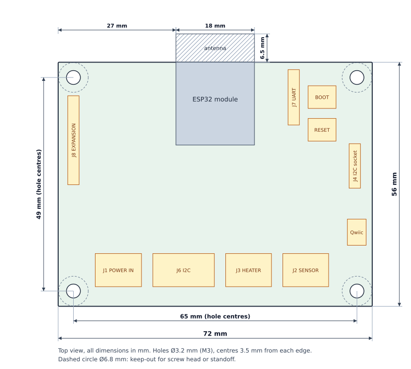

# Board reference

## Dimensions

| | |
|---|---|
| Board | 72 × 56 mm, 1.6 mm thick |
| Mounting holes | 4 × Ø3.2 mm (M3), centres 3.5 mm from each edge |
| Hole spacing | 65 mm × 49 mm (centre to centre) |
| Keep-out around each hole | Ø6.8 mm, for screw heads, nuts or standoffs |
| ESP32 antenna | overhangs the top edge by 6.5 mm, 27 mm from the left edge, 18 mm wide; overall length with antenna 62.5 mm |

For an enclosure or holder: leave about 15 mm above the board for the screw terminals, pin headers and plugged cables, and about 3 mm below for the through-hole solder joints (e.g. 3–5 mm standoffs). The screw terminals sit along the bottom edge, so plan room for the cables there. Keep metal and enclosure walls away from the antenna. Measure your own terminals and headers if you use different parts.

[`mechanical/board-outline.dxf`](../../mechanical/board-outline.dxf) holds the outline, the holes, the antenna area and the connector positions for import into CAD (mm, origin at the bottom-left corner, top view; one layer each: OUTLINE, HOLES, ANTENNA, CONNECTORS).

## Overview

- 2 layers; size and holes see [Dimensions](#dimensions).
- Input: **5 V** (e.g. Waveshare Solar Power Manager (D), USB, any 5 V supply up to 3 A). No solar or battery charging on this board.
- On board: AP2112K 3.3 V LDO; MT3608 boost to a fixed **12 V** for the heater, switched by GPIO13 through a low-side MOSFET; reverse-polarity PMOS; SN74HC14 relaxation oscillator; NTC divider; optional battery voltage divider; I2C pull-ups; BOOT and RESET buttons; UART header.
- I2C on Qwiic/STEMMA QT (JST-SH), a 1×4 2.54 mm socket and a 4-pin screw terminal, all in parallel.

## Connectors

| Ref | Function | Pins (1 → n) |
|---|---|---|
| J1 | Power in | 5V, GND, BAT (battery voltage sense, optional) |
| J2 | Sensor capacitor / NTC | OSC (capacitor node), GND, NTC |
| J3 | Sensor heater | GND, HEAT- (switched return), +12V |
| J4 | I2C socket, silkscreen "HTU21D" (any 3V3/GND/SCL/SDA module) | 3V3, GND, SCL, SDA |
| J5 | Qwiic (silkscreen, top to bottom: 4 SCL, 3 SDA, 2 3V3, 1 GND) | GND, 3V3, SDA, SCL |
| J6 | I2C screw terminal | 3V3, GND, SDA, SCL |
| J7 | UART programming | GND, TXD, RXD, IO0, EN (no power pin; power the board via J1) |
| J8 | Expansion | 3V3, GND, IO32, IO33, IO26, IO27, IO14, IO4 |

Each screw terminal is labelled below the block with pin function and number. On HEATER and SENSOR, `#n` is the RC-SPC1KA pin number (`#-` = unused). The J2/J3 order keeps the sensitive oscillator node away from 12 V.

## GPIO map

| GPIO | Use |
|---|---|
| 21 / 22 | I2C SDA / SCL (4.7 k pull-ups) |
| 13 | Heater enable: boost EN and MOSFET gate (100 k pull-down, default off) |
| 25 | Oscillator input (PCNT) |
| 34 | NTC (2.8 k pull-up to 3V3 via SJ1) |
| 32 | Alternative NTC pull-up drive: move SJ1 to pad 3 to power the divider only when needed |
| 35 | Battery voltage through 100k/100k (SJ2 bridged by default; cut it to remove the divider load) |
| 0 / EN | BOOT / RESET buttons and J7 |

## Solder jumpers

- **SJ1** (default: 3V3 → NTC pull-up). Cut and bridge the other side to drive the pull-up from GPIO32.
- **SJ2** (default: bridged). Closes the battery divider to GND. Leave it bridged; if open, GPIO35 sees the unattenuated battery voltage.

