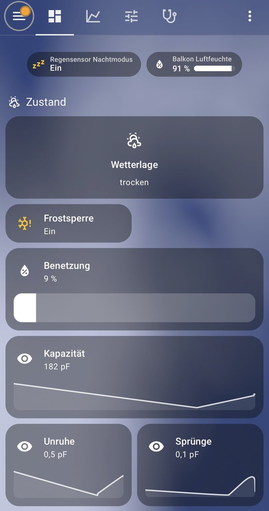

# Entities

The DE firmware uses German entity names, the EN firmware English ones. Logic and defaults are identical. You change every setting at runtime; the device keeps it across reboots and sleep.

A Home Assistant dashboard for the German firmware on a phone.

## States

| DE | EN | Meaning |
|---|---|---|
| Wetterlage | Weather State | trocken / dry, Regen / Rain, Stillstand / Stalled |
| Regen | Rain | binary: on while it rains; off while the oscillator stalls |
| Feucht | Humid | binary: plate above the *Dew Heating* level |
| Frostsperre | Frost Lock | binary: plate was below 1 °C and has not been dry since; no rain reported |
| Kapazität | Capacitance | capacitance in pF |
| Kapazität Änderungsrate | Capacitance Rate of Change | pF/min, 1-min mean |
| Kapazität Unruhe | Capacitance Unrest | standard deviation over 5 min, pF |
| Kapazität Sprünge | Capacitance Steps | RMS of the 10-s changes over 2 min without the largest, pF; compared with *Rain Start Steps* |
| Benetzung | Wetness | wetting in % (RC-SPC1KA datasheet curve) |
| Oberflächentemperatur | Surface Temperature | plate temperature from the NTC |
| Frequenz | Frequency | oscillator frequency (diagnostic) |
| Oszillator steht | Oscillator Stalled | oscillator stopped; weather state held, one drying attempt of up to 10 min |
| Heizkonto, Sperre verbleibend, Heizsperre aktiv | Heating Account, Lockout Remaining, Heating Lockout Active | heating-time budget state |
| Helligkeit, Sonneneinstrahlung | Brightness, Solar Irradiance | VEML7700 (optional) |
| Box Temperatur, Box Luftfeuchte | Box Temperature, Box Humidity | HTU21D in the enclosure |
| Batteriespannung | Battery Voltage | through the 100k/100k divider (optional) |

## Settings

| DE | EN | Default | Meaning |
|---|---|---|---|
| Trockenfrequenz | Dry Frequency | 125000 Hz | frequency of the dry plate, defines 100 pF ([calibration](Calibration.md)) |
| Schwelle Niederschlagserkennung | Precipitation Detection Threshold | 4 pF/min | a faster rise starts rain |
| Sprünge Regenbeginn | Rain Start Steps | 0.7 pF | steps from here start rain on a wet plate |
| Schwelle für Regenende | Rain End Threshold | 3 min | rain ends after this long calm |
| Trocken bis | Dry Below | 115 pF | below this, calm and without a rise: dry |
| Trocknung nach Regenende | Drying After Rain | 6 min | length of the drying run, 15 min after rain ends |
| Trocknungslauf | Drying Run | on | switch for the drying run |
| Tauheizung | Dew Heating | 200 pF | heating level for frost below 1 °C |
| Heiztemperatur | Heating Temperature | 45 °C | heater off at this plate temperature, on again 5 K below |
| Max. Heizdauer, Pause je Heizminute, Heizsperre | Max. Heating Time, Pause per Heating Minute, Heating Lockout | 15 min, 6 min, 120 min | heating-time budget |
| Heizung, Automatikbetrieb | Heater, Auto Mode | off, on | heater switch; master switch for automatic heating and night mode |
| Nachtmodus | Night Mode | off | allows deep sleep in the night window |
| Nachtmodus von / bis / bis (Wochenende) | Night Mode From / Until / Until (Weekend) | 22 / 5 / 6 | night window in hours; half hours as .5, e.g. 22.5 = 22:30 |
| Temperatur-Offset (NTC) | Temperature Offset (NTC) | 0 K | fine trim of the plate temperature |
| Helligkeitsfaktor VEML | VEML Brightness Factor | 1.0 | compensates a cover over the VEML7700 |
