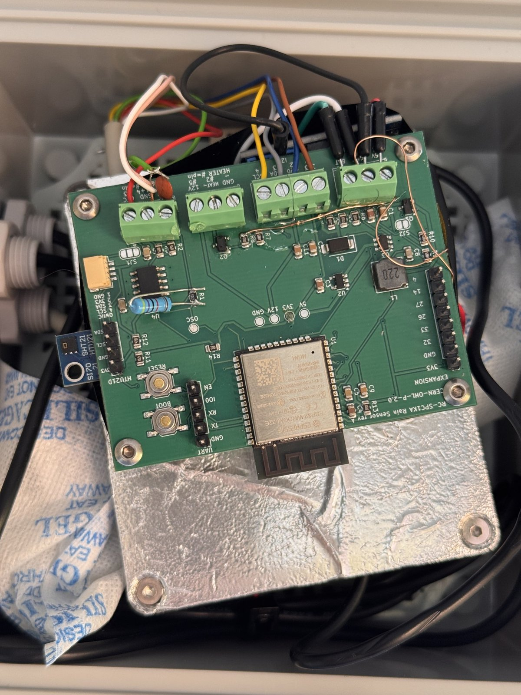

# Milestones

How I got the sensor to where it is, dead ends included. Each setback carries a short note on what I learned, so you can skip the same mistakes.

### Early September 2026: a rain sensor that does not corrode
Affordable rain sensors use copper comb boards that corrode within a season. I considered coating one with gold leaf and dropped the idea: the leaf does not bond and the copper corrodes at each pore. A Zigbee comb sensor served as a stopgap. For the real solution I followed Magnus Thomé's capacitive rainmeter with the sealed, heated RC-SPC1KA element.

### Early September: a heater does not run on batteries *(setback)*
My first plan assumed battery power alone, which rules out a heater. I answered that with a small solar system: an 18 V / 10 W panel, a Waveshare Solar Power Manager, three 18650 cells and a 5 V to 12 V boost converter that switches off together with the heater.

**Learned:** the heater sets the power budget; the rest draws little.

### Mid September: dew point dropped, then back for free
I planned an SHT31 for the dew point, then dropped it to save a sensor and let the heater work on capacitance bands alone. Later the outdoor sensor already in Home Assistant supplied temperature and humidity, and the dew point came back without extra hardware.

**Learned:** use the data the smart home already has.

### Mid September: first build
I built a Wemos D1 mini (ESP8266) on perfboard and measured capacitance as charge time through 1 MΩ, as in the reference project. I glued the sensor into a printed ASA holder and covered the contacts on the back with Kapton tape.

### ~20 September: capacitance always "NaN" *(setback)*
The measurement never returned a value. I checked the sensor, the cable, the GPIOs and the solder joints, and they were fine. The 1 MΩ charge resistor was too large for this measuring method.

### 24 September: charge-time measurement hits its limit *(setback)*
With 500 kΩ the samples jumped around; 100 kΩ worked but read about 166 pF dry, and drizzle stayed below the threshold. A small leakage at the measuring node keeps the voltage from reaching the ESP8266 switching point at 75 % of the supply, and a larger resistor makes it worse. The datasheet's reference circuit uses a Schmitt-trigger oscillator, which switches at about half the supply.

**Learned:** follow the measuring principle the manufacturer designed the element for.

### 25 September: frequency measurement on an ESP32
I switched to an SN74HC14 Schmitt-trigger relaxation oscillator. On the ESP8266 the I2C reads disturbed the software counting, so I moved to an ESP32 and its hardware pulse counter (PCNT). The firmware now calculates capacitance relative to the measured dry frequency, which needs no offset calibration.

**Learned:** hardware counting gives far less noise than software interrupts.

### 26 September: night mode needed a different charge controller *(setback)*
The Waveshare Solar Power Manager (C) switched its output off at low load, so the ESP32 never woke from deep sleep. The (D) version keeps the output on in low-current mode. I also replaced the DHT11 with an HTU21D.

**Learned:** check that the supply stays on at a few mA before you rely on deep sleep.

### 26 September: Rev A carrier board
I designed the board in KiCad, ordered it fully assembled from JLCPCB and created the repository.

### 27 September: weather state logic
I added dew detection via the distance to the dew point, a frost point below 0 °C, morning and evening dew, and hysteresis against flickering states.

### 28 September: placement error caught before production *(setback)*
The JLCPCB preview showed U2 and U3 (SOT-23-5/6) rotated by 90°. I fixed the rotation in the CPL file.

**Learned:** check pin 1 of each IC in the assembly preview.

### 1 October: standalone variant
I added a local web page and MQTT for FHEM, ioBroker and others, plus English firmware alongside German.

### 2 October: first real rain, oscillator stalled *(setback)*
The frequency dropped to 0 Hz. Water on the plate added a leakage path that the oscillator could not drive with a 1 MΩ feedback resistor. Before that, dew had read almost like rain, and the sensor missed rain. I changed R1 to 220 kΩ.

**Learned:** lab tests with a damp cloth do not replace real rain.

### 3 October: test series with 220 kΩ
The oscillator stayed stable in each test: dry ~100 pF, spray mist ~270, three drops ~290, heavy spray ~600, soaked cloth 870–1240 pF. The firmware now detects drizzle and rain by rate of rise, with a rain-end timer and a short heater test.

### 3 October: false rain alert *(setback)*
A notification fired without rain because the automations listened to "humid" instead of "rain". I switched them to the rain sensor.

### 4 October: night behaviour and first fog morning
I removed the short "unknown" states after each wake; the firmware restores the last weather state across sleep. The heater no longer runs while dew or frost forms, which saves energy. I logged the first fog morning: capacitance stayed flat at ~187 pF while the plate warmed a little. I added morning drying, one short heat pulse a day once the surface is above the dew point. In fog the surface got wet again within ten minutes of a heat pulse (about 7 pF/min) although it was above the dew point; I noted that re-wetting as a candidate for fog detection.

### 8 October: Rev A arrives, oscillator stalls in steady rain *(setback)*
The assembled boards came with 1 MΩ for R1, so I changed it to 220 kΩ as on the prototype. In steady rain the prototype oscillator dropped to 0 Hz and ran again after I wiped the plate. Water had reached the solder pads at the edge of the sensor.

**Learned:** seal the back and the edge of the element as well as the face.

### 9 October: rain only, no dew logic
I took dew, frost, fog and morning drying out of the firmware. They needed outdoor temperature and humidity and misjudged too often. The firmware detects drizzle and rain by rate of rise and heats when the surface is wet; it needs no outdoor data and no blueprint.

**Learned:** each weather state added a way to be wrong.

### 9–10 October: battery empty overnight *(setback)*
The heater ran at dew level and kept trying to dry a stalled oscillator until the battery was flat. I raised the heating threshold above the dew level (300 pF) and capped heating against a stalled oscillator at 10 minutes per episode.

**Learned:** a heating rule needs a limit that holds when the reading is wrong.

### 10 October: water inside the sensor head *(setback)*
Runoff collected under the sensor on the lid and crept into the box by capillary action. A silica pad went in as a stopgap. The new head had to leave no gap below the sensor.

### 11 October: false drizzle from passing clouds *(setback)*
Clouds after sunshine cooled the plate, it took up humidity and the firmware read that as drizzle. The firmware now blocks the drizzle latch while the plate cools (2 K below the peak of the last 5–10 minutes). I tried a 30-second median against dew noise and dropped it, because it would have hidden real drizzle too.

**Learned:** blocking drizzle during cooling works better than smoothing the signal.

### 12 October: frost melt stalls the sensor, prototype taken down *(setback)*
At −1 °C the heater melted frost. The water ran to the edge of the flat holder and stalled the oscillator. Heating did not dry it; wiping did. The same night exposed a firmware bug: the oscillator ran while the plate was hot, which reset the 10-minute limit, so the heater came on at each wake. The limit now resets once the plate has cooled. I took the prototype down.

**Learned:** the holder must give water no place to stand, and a drying limit has to judge a cooled plate.

### 12 October: 45° tilt
In a drop test a drop stayed at 20°, slid from about 30° and at 45° smaller drops slid too. A steeper angle adds little and loses catch area for drizzle. Turning the sensor onto a corner made no difference.

### 13–14 October: new sensor holder
The sensor sits proud on a pedestal a little smaller than the element, so water drips off all four edges. Gutters and side shields run beside it without touching it, and the cable slot sits at the lower edge. The holder is white ASA-GF, primed and painted. An elastic MS-polymer sealant bonds the sensor and seals the whole back instead of potting; it stays elastic while the plastic expands with heat.

### 15 October: Rev A in service
I flashed the board once over UART; the API key now encrypts OTA updates. Home Assistant moved the existing device onto the new board ("migrate" in the name-conflict dialog) and kept entity IDs, dashboard and history. Battery voltage reads correctly. An aluminium plate 2 cm behind the antenna reflects the WiFi signal towards the access point.

### 17 October: bench test on Rev A
With the same cable as on the prototype, the dry frequency rose from 14.6 to 35 kHz. The board carries less stray capacitance at the oscillator than the perfboard did. A wet surface reads 31 times the dry value instead of 10 times, and a single drop doubles the reading. The heater warmed the plate from 23 to 45 °C in 30 seconds. While it runs, the oscillator stops. The firmware skips readings during heating and pauses the heater for a clean one.

**Learned:** stray capacitance in the wiring dilutes the signal more than the cable does.

### 18–21 October: the heater stops the oscillator *(setback)*
I tested the Rev A board on a lab supply. With the MT3608 boost converter on the board running, the oscillator stopped completely. An external XL6009 with its return through the board ground via HEAT− still made the frequency jump. A 1000 µF capacitor at the boost input made it slightly worse. The frequency stayed stable only once the XL6009 and the MOSFET that switches its input return had no connection to the ground of the rest except at the supply.

**Learned:** the boost converter and the heater current have to stay off the logic ground completely; they meet it only at the supply.

### 21–22 October: Rev B carrier board
I redesigned the board around the tested setup: an ESP32 D1 mini on sockets, the XL6009 as a plug-in module, a MOSFET in its input return and a separate heater return to the power terminal. The HTU21D moved onto the board, on a slotted tongue that keeps the board heat away. Screw terminals are grouped by function, and the GPIO map is printed on the board.

### 22 October: night mode, second try *(setback)*
After the first sleep the sensor did not come back until morning. The Waveshare Solar Power Manager (D) cuts its 5 V output at low load unless you switch it to low-current mode with a double click on its function button. After that it woke every 5.5 minutes.

**Learned:** the charger's low-current mode has to be switched on by hand.

### 22–23 October: humidity and sealant
Indoors the dry frequency moved by up to 3 % in a day. It followed the humidity in the enclosure closely, by about 0.2 % per percentage point, and the room humidity only loosely. After I sealed the sensor head, the curing sealant shifted the reading for about a day. I now set the dry frequency outdoors, once the sealant has cured.

### 24 October: first rain on the Rev A board *(setback)*
In steady rain the 45° plate settled at about 170 pF and rose by only 10–20 pF/min at the start. The thresholds scaled from the prototype (drizzle 30 pF/min, rain level 800 pF) missed it. A spray test rose by 287 pF/min, and the firmware still reported dry: the cold water cooled the plate by 2.4 K, and the block against "cooling after sunshine" held the drizzle latch. I removed that block, since a cloud that cools the plate may well bring rain. After about an hour of rain the oscillator stopped; wiping the plate started it again.

**Learned:** set thresholds from real rain, not from scaled bench values.

### 25 October: a water film on the face stops the oscillator *(setback)*
The oscillator stopped again in rain although I had sealed a damaged spot on the face. During the stall the oscillator output sat at 3.3 V: the input stayed below its switching point. Water on face A formed a resistor from OSC to GND that R1 could not drive. Wiping the plate ended each stall.

### 25 October: rain moves the level, it does not set it
Next to a tipping-bucket gauge, light rain read 240–270 pF and heavy rain 160–170 pF: heavy rain runs off. The sensor reported rain about 10 minutes before the first tip. I replaced the rate thresholds with two measures of how restless the level is: the unrest (standard deviation over 5 minutes) and the steps between 10-second readings. Rain ends after 3 calm minutes, and one drying run follows. The heater test at the end of rain went away.

**Learned:** rain shows in how the level jumps, dew and a resting film in how calm it stays.

### 25 October: two firmware sources *(setback)*
The ESPHome Device Builder in Home Assistant flashed its older copy over my builds twice in one morning. I now build from one place and copy the result to the Device Builder after each flash.

### 28 October: R1 against the leak
I measured the leak through the film: 76.6 kΩ from OSC to GND. With 47 kΩ soldered parallel to R1 (38.7 kΩ in total) the oscillator ran through a spray test at 191 pF.

### 6 November: thawing frost stops it anyway *(setback)*
At sunrise frost on the plate thawed into a closed film, and the oscillator stopped despite the smaller R1. Before that the meltwater set off a false rain alert. I limited the dew heating to a plate below 1 °C, where frost forms.

**Learned:** a smaller R1 only moves the limit; the film can always conduct better.

### 7 November: a capacitor in series ends the stalls
I soldered a 100 nF capacitor in series between the board and the sensor. It blocks the DC path through the water film; the oscillator only sees the AC through the sensing capacitor. Since then it has not stopped once, in rain or in thawing frost at 460 pF.

Rev A, the second prototype, with its hand-soldered fixes: 47 kΩ parallel to R1 (blue, left of centre), the 100 nF series capacitor at the sensor terminal (orange, top left) and wires for the external heater module. Rev B includes all of these fixes on the board.

**Learned:** block the leak instead of out-driving it.

### 11 November: rain on a plate that is already wet
Light rain on a soaked plate barely moved the level and the sensor missed it. A new start rule watches the steps over 2 minutes and ignores a plate that dries in small steps. At night the sensor compares its 5-minute wakes: two restless wakes in a row start rain. From now on only the sensor reports rain; the gauge serves as reference.

### 15 November: one lone step is not rain *(setback)*
On an almost dry morning a single 6 pF drop set off a rain alert. The start rule now leaves out the largest step of the last 2 minutes.

### 16–17 November: two days of rain, drizzle goes *(setback)*
In steady rain the weather state switched between drizzle and rain 42 times a day. The heaviest rain read as drizzle: it forms a smooth running film with small steps. The binary rain sensor went off during each "drizzle", so Home Assistant split one rainy day into many events. I dropped drizzle: the sensor reports rain or dry, and the gauge gives the amount. The start came 2–5 minutes before the first tip of the gauge.

**Learned:** report only what the sensor can tell apart.

### 17 November: frost lock
The logs of two frosty mornings showed meltwater that moved like rain for an hour, at a plate temperature up to 10 °C in full sun. Below 1 °C the sensor now reports no rain until the plate is above 1 °C and dry again.

### 17 November: Rev B gets the fixes
Rev B takes over the series capacitor (C3) and uses R1 = 47 kΩ, a basic part at JLCPCB, close to the 38.7 kΩ tested on Rev A.

### Next
See [Roadmap](Roadmap.md).
