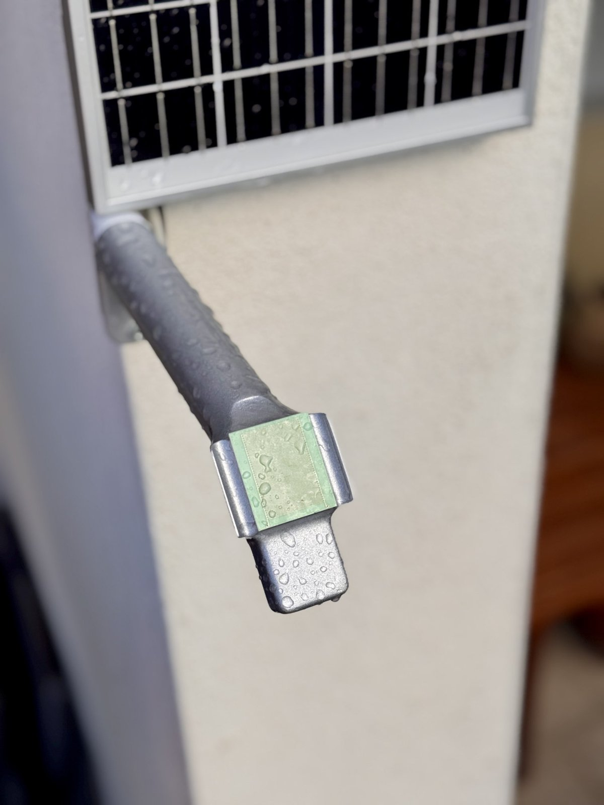
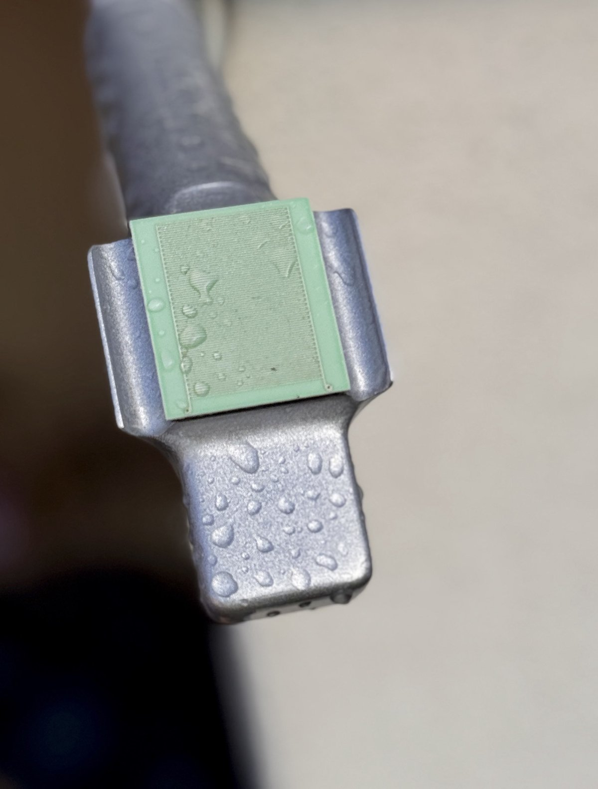
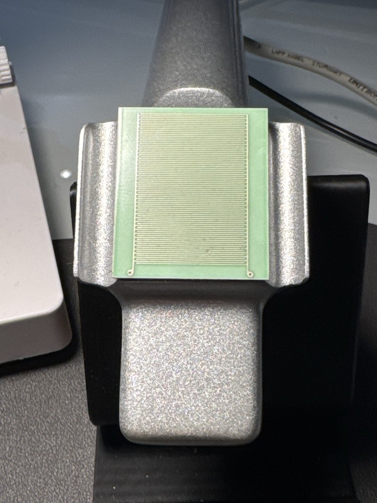
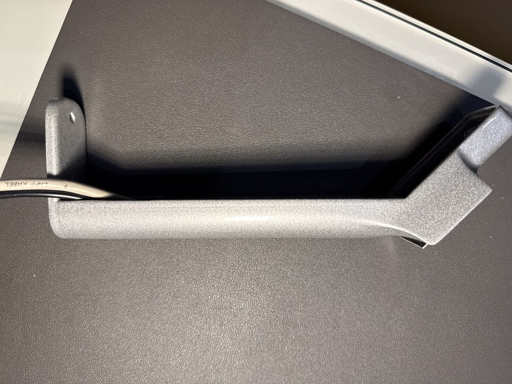
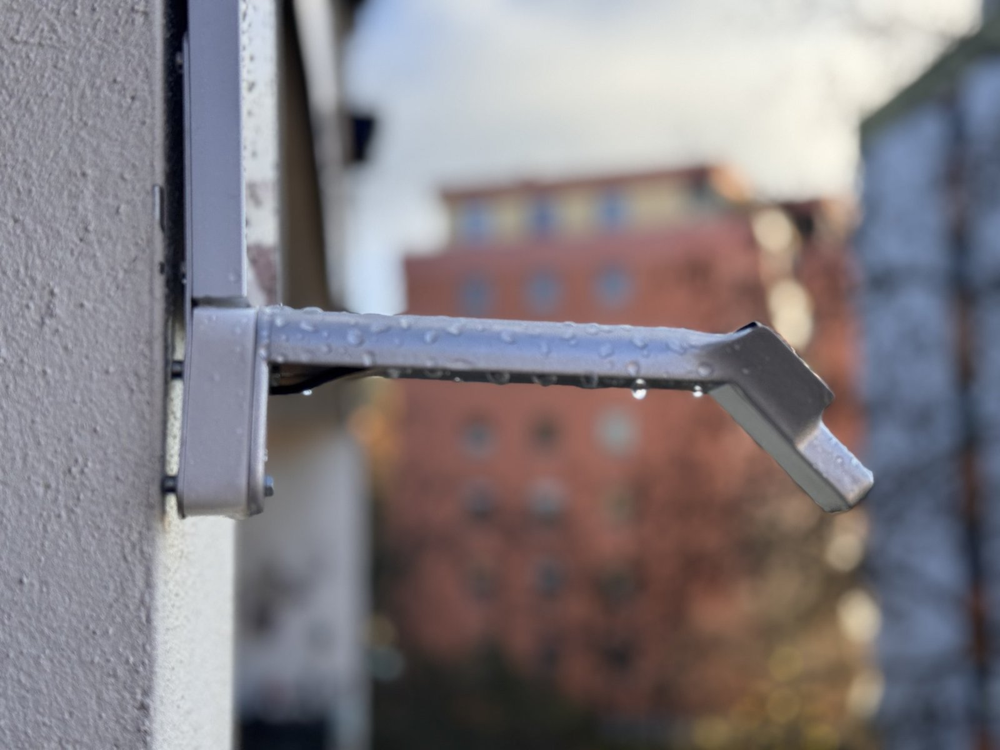
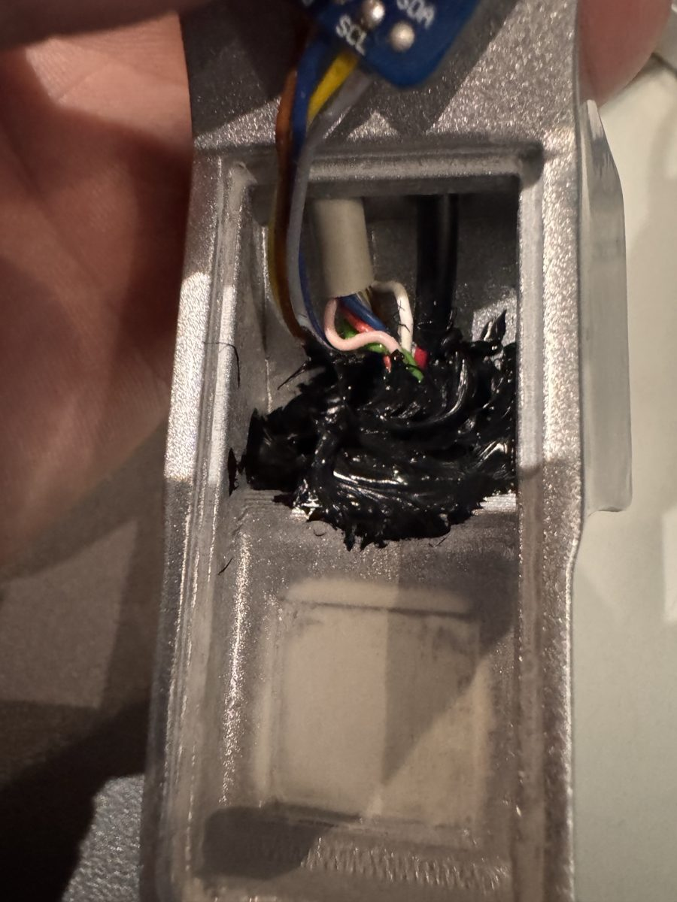
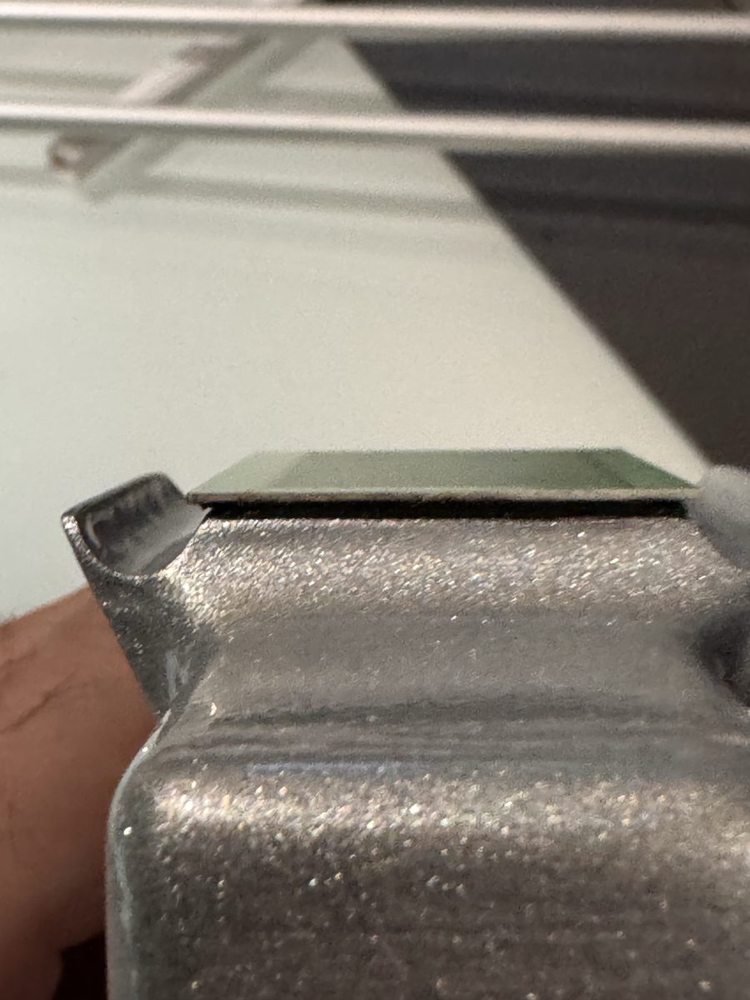

# Sensor holder

Three parts in `3d-files/`:

| File | Part | Size (mm) |
|---|---|---|
| `sensor-holder-main.stl` | Holder with arm, sensor head and wall foot | 70 × 48 × 205 |
| `sensor-holder-lid.stl` | Bottom lid of the sensor head; gives access for mounting, then glued shut | 57 × 26 × 2 |
| `sensor-holder-plate.stl` | Adapter to extend the holder (optional) | 59 × 59 × 20 |

The finished holder on the balcony after rain: white ASA-GF, painted silver. Right: the sensor sits proud on its pedestal, the gutters run beside it without touching it.

The sensor face sits at 45°. At that angle small drops slide off; a steeper face adds little and catches less drizzle.

## Material and finish

- **ASA-GF or ASA, white.** ASA resists UV and weather; white keeps the head from heating up in the sun. PLA and PETG do not last outdoors.
- The prototype was printed on a Bambu Lab X1C in ASA-GF with 4 walls and 30 % gyroid infill.
- **Paint the parts.** The holder stays outside in all weather, and FDM prints are not watertight: without a coat, water gets into the part. Prime and paint all printed parts with a UV-stable outdoor finish in a light colour; light grey or silver works as well as white. Keep the sensor face free of paint.

## Mounting the sensor

> [!IMPORTANT]
> The back of the RC-SPC1KA carries the heater and NTC solder pads without corrosion protection. Seal the back and the whole edge so no water reaches it.

- Solder the wires and **test the sensor and the VEML7700 before gluing**; afterwards you cannot rework anything.
- Coat the solder pads with a conformal coating (insulating varnish for PCBs) and let it dry fully before sealing; mask the sensor face.
- Turn the sensor so the solder pads sit at the lower edge and the cable leaves downwards through the slot.
- Bond the sensor with an elastic, neutral-curing sealant (PU or MS polymer, e.g. Sikaflex) and seal the whole back with it. The elastic bond takes up the thermal expansion of the plastic, which would otherwise stress the 0.65 mm ceramic. Acetic-acid silicone (vinegar smell) attacks solder joints and copper.
- The pedestal is a little smaller than the element, so water drips off all four edges. Keep sealant off the face and off these edges; a bead there holds a water film and reads as wet.
- Degrease the bonding surfaces (isopropanol). These sealants cure from the outside in at about 3 mm per day; a 1 mm layer needs one to two days at room temperature before the holder goes outside.
- Fit the VEML7700 in the head, then glue the bottom lid shut.
- Measure the dry frequency again once the sealant has cured (see [Calibration](Calibration.md)).
- If the VEML7700 sits behind a cover or paint, set *VEML Brightness Factor* (default 1.0, up to 10) to lux without the cover divided by lux behind it, read right after each other in steady light; no reflash needed.
- Lead the cable away with a drip loop and add strain relief. Use an outdoor-rated cable (plain LiYY is not UV resistant).
- Use stainless screws for wall mounting.

Left: back sealed, pads and wire ends embedded. Right: the joint sits recessed under the ceramic, so no bead holds water at the edge.

