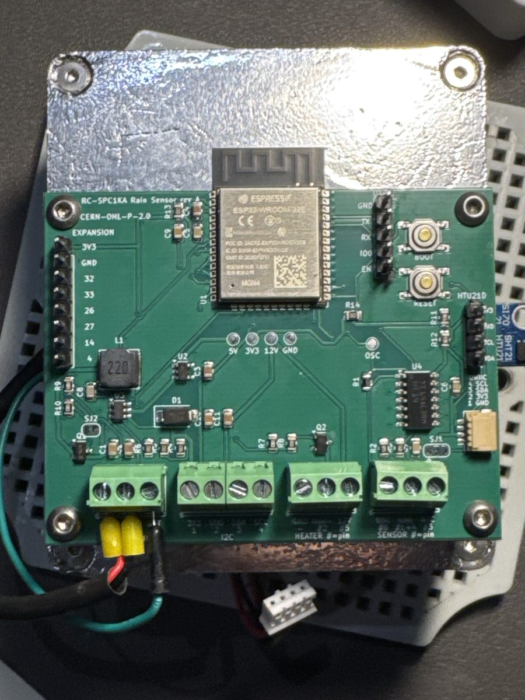

# Wiring

Sensor pin numbers follow the RC-SPC1KA datasheet. The silkscreen prints them next to the terminals (`#6`, `#1+4`, …).

| Terminal | Board pin | Sensor pin | Function |
|---|---|---|---|
| SENSOR | OSC | 6 | capacitor, oscillator node |
| SENSOR | GND | 1 and 4 | capacitor ground side (outer electrode), NTC |
| SENSOR | NTC | 3 | NTC |
| HEATER | HEAT+ | 5 | heater, +12 V |
| HEATER | HEAT− | 2 | heater return |

The sensor has three isolated groups: capacitor (1, 6), heater (2, 5, about 42 Ω) and NTC (3, 4, about 1 kΩ at room temperature). Pins 1 and 4 are joined only on the board, at SENSOR GND. Keep the heater pins away from the SENSOR terminal: the heater return has its own path on the board and must not share a wire with the sensor ground. A quick check with a multimeter before powering up catches wiring mistakes.

> [!WARNING]
> OSC must never touch 12 V.

Power goes to POWER IN (5V, GND). The board has no reverse-polarity protection, so check the polarity before you switch on. BAT is only for battery voltage monitoring (1S Li-ion, up to 4.2 V through a 100k/100k divider); leave it open otherwise.

Connect the VEML7700 to the I2C terminal, the I2C socket or the I2C header. The HTU21D for the enclosure air is already on the board.

The enclosure with the Rev A board. Left: the board on brass standoffs, an aluminium plate 2 cm behind the antenna as reflector. Right: behind the board sit the Waveshare Solar Power Manager (D) and three 18650 cells.

