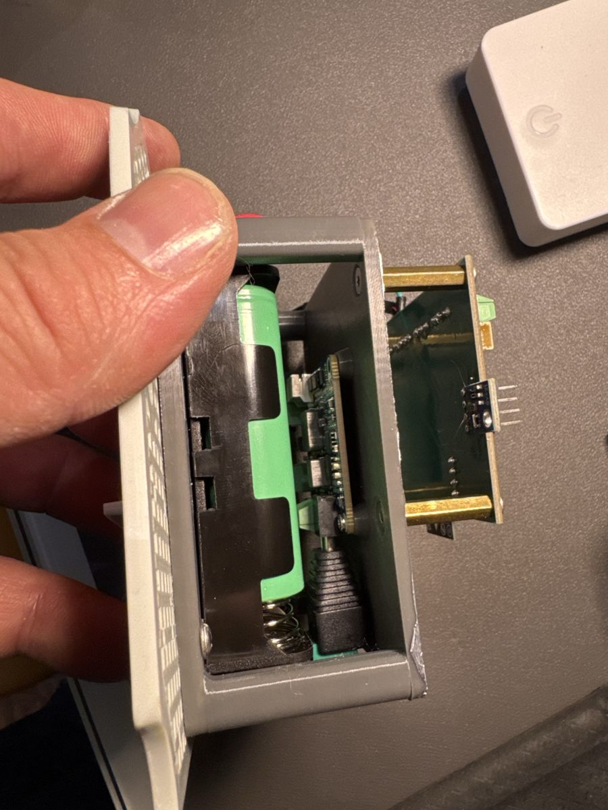

# Wiring

Sensor pin numbers follow the RC-SPC1KA datasheet. The silkscreen prints them next to the terminals (`#6`, `#1+4`, …).

| Terminal | Board pin | Sensor pin | Function |
|---|---|---|---|
| SENSOR | OSC | 6 | capacitor, oscillator node |
| SENSOR | GND | 1 and 4 | capacitor ground side (outer electrode), NTC |
| SENSOR | NTC | 3 | NTC |
| HEATER | HEAT- | 2 | heater, switched ground |
| HEATER | 12V | 5 | heater, +12 V |
| HEATER | GND | – | not used |

The sensor has three isolated groups: capacitor (1, 6), heater (2, 5, about 42 Ω) and NTC (3, 4, about 1 kΩ at room temperature). Pins 1 and 4 are joined only on the board, at SENSOR GND. A quick check with a multimeter before powering up catches wiring mistakes.

> [!WARNING]
> OSC must never touch 12 V.

Connect the VEML7700 to the I2C terminal or the I2C header, the HTU21D to the socket labelled HTU21D. Power goes to POWER IN (5V, GND; reverse-polarity protected). BAT is only for battery voltage monitoring (1S Li-ion, up to 4.2 V through a 100k/100k divider); leave it open otherwise.

Rev A in the enclosure. Left: the board on brass standoffs, an aluminium plate 2 cm behind the antenna as reflector. Right: behind the board sit the Waveshare Solar Power Manager (D) and the 18650 cells; the HTU21D plugs into its socket.

